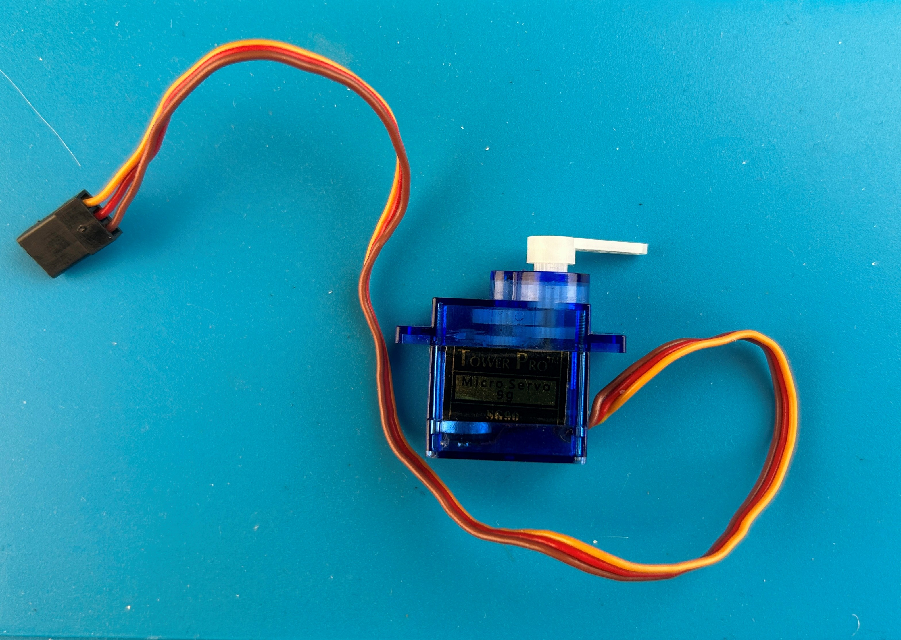

# ESP32_Servo

An Arduino library for controlling hobby servo motors with ESP32 boards. It
gives you separate classes for **standard positional** servos and
**continuous rotation** servos. Both support speed control, smooth motion and
non-blocking operation.

<p align="center">
  
  <br>
  <em>A Tower Pro SG90 micro servo. Wires: <b>orange</b> = signal (to an ESP32 GPIO),
  <b>red</b> = V+ (5 V), <b>brown</b> = ground.</em>
</p>

- Works with **Arduino-ESP32 core 2.x and 3.x**
- Supports **ESP32, ESP32-S2, ESP32-S3, ESP32-C3, ESP32-C6, ESP32-H2**
- Uses the hardware **LEDC** PWM peripheral, so there is no jitter from software timing

## Features

| `PositionalServo` | `ContinuousServo` |
|---|---|
| `write(angle)`: instant positioning | `setSpeed(-100..100)`: direction and speed in % |
| `setSpeed(deg/s)` and `moveTo()`: speed-limited, non-blocking | `setAcceleration(%/s)`: smooth ramps |
| `moveTo(angle, ms)`: timed moves, for synchronizing several servos | `runFor(speed, ms)`: timed runs that stop automatically |
| Easing: Linear, EaseIn, EaseOut, EaseInOut | `forward()`, `backward()`, `stop()`, `softStop()` |
| `setLimits(min, max)`: software end stops | `setNeutral(us)`: stop-point calibration |
| `setTrim(deg)`, `setReversed(bool)` | `setDeadband(%)`, `setReversed(bool)` |
| 180°, 270° or any custom travel range | Custom min/neutral/max pulse widths |

Both classes derive from `ServoBase`. It provides `attach`/`detach`,
`writeMicroseconds()`, `setPulseRange()` and a virtual `update()`, so you can
manage mixed collections through `ServoBase*` pointers.

## Installation

**Arduino IDE (Library Manager / ZIP)**
1. Download this repository as a ZIP (*Code → Download ZIP*).
2. In the Arduino IDE choose *Sketch → Include Library → Add .ZIP Library…*.
3. Make sure an ESP32 board package is installed (*Boards Manager → "esp32" by Espressif*).

**Manual**: clone into your Arduino `libraries` folder:
```sh
cd ~/Documents/Arduino/libraries
git clone https://github.com/YOUR_GITHUB_USER/ESP32_Servo.git
```

**PlatformIO**: add to `platformio.ini`:
```ini
lib_deps = https://github.com/YOUR_GITHUB_USER/ESP32_Servo.git
```

## Quick start

```cpp
#include <ESP32_Servo.h>

PositionalServo servo;

void setup() {
    servo.attach(18);          // GPIO 18, 500-2500 us, 0-180 deg
    servo.setSpeed(60);        // 60 degrees per second
    servo.setEasing(ServoEasing::EaseInOut);
    servo.moveTo(180);         // non-blocking
}

void loop() {
    servo.update();            // advances the motion; returns false when done
}
```

```cpp
#include <ESP32_Servo.h>

ContinuousServo wheel;

void setup() {
    wheel.attach(19);          // 1000-2000 us, neutral 1500 us
    wheel.setAcceleration(200);// 0 -> 100% in 0.5 s
    wheel.forward(75);         // 75% forward
}

void loop() {
    wheel.update();
}
```

## Examples

| Example | Description |
|---|---|
| [01_BasicSweep](examples/01_BasicSweep/01_BasicSweep.ino) | Sweep one servo with `write()`, the classic first test |
| [02_BackAndForth](examples/02_BackAndForth/02_BackAndForth.ino) | 0° → 90°, wait 2 s, 90° → 0°, wait 2 s, repeat |
| [03_PotentiometerControl](examples/03_PotentiometerControl/03_PotentiometerControl.ino) | A potentiometer on an analog pin sets the angle from 0 to 180°, with smoothing |
| [04_SpeedAndEasing](examples/04_SpeedAndEasing/04_SpeedAndEasing.ino) | Non-blocking speed-limited moves through each easing profile while an LED blinks |
| [05_ContinuousRotation](examples/05_ContinuousRotation/05_ContinuousRotation.ino) | Continuous servo with acceleration ramps, soft stop and timed runs |
| [06_MultiServo](examples/06_MultiServo/06_MultiServo.ino) | 4-joint arm and a conveyor: synchronized poses, per-servo limits/trim/reverse, mixed types |

## Versioning

Each header defines its own version as a `"major.minor"` string, for example:

```cpp
#include <ESP32_Servo.h>

Serial.println(ESP32_SERVO_LIBRARY_VERSION);      // "1.2"
Serial.println(POSITIONALSERVO_LIBRARY_VERSION);  // "1.2"
```

The major version changes only for significant releases, and the minor
version increases with every change. Each header also contains a revision
history.

## API reference

### `PositionalServo`

```cpp
bool  attach(int pin, uint16_t minUs = 500, uint16_t maxUs = 2500,
             float maxAngle = 180, uint32_t freqHz = 50, int channel = ESP32_SERVO_AUTO_CHANNEL);
void  write(float angle);                 // instant
float read();                             // current commanded angle
void  setSpeed(float degPerSec);          // 0 = instant
void  setEasing(ServoEasing e);           // Linear / EaseIn / EaseOut / EaseInOut
void  moveTo(float angle);                // non-blocking, uses setSpeed()
void  moveTo(float angle, uint32_t ms);   // non-blocking, fixed duration
void  moveBy(float delta);
void  moveToBlocking(float angle);        // waits until done
void  moveToBlocking(float angle, uint32_t ms);
bool  update();                           // call from loop(); true while moving
bool  isMoving();
void  stop();                             // freeze at present position
float getTarget();
void  setLimits(float minAngle, float maxAngle);
void  setTrim(float degrees);
void  setReversed(bool reversed);
```

### `ContinuousServo`

```cpp
bool  attach(int pin, uint16_t minUs = 1000, uint16_t maxUs = 2000,
             uint16_t neutralUs = 1500, uint32_t freqHz = 50, int channel = ESP32_SERVO_AUTO_CHANNEL);
void  setSpeed(float percent);            // -100..100, ramps if acceleration set
void  setSpeedImmediate(float percent);   // ignores acceleration
float getSpeed();                         // speed being output now
float getTargetSpeed();
void  forward(float percent = 100);
void  backward(float percent = 100);
void  stop();                             // immediate
void  softStop();                         // ramp down
void  runFor(float percent, uint32_t ms); // non-blocking timed run
bool  update();                           // call from loop(); true while ramping / timed run
bool  isRamping();
bool  isRunning();
void  setAcceleration(float percentPerSec); // 0 = off
void  setNeutral(uint16_t us);
void  setDeadband(float percent);
void  setReversed(bool reversed);
```

### `ServoBase` (shared)

```cpp
void     detach();
bool     attached();
int      pin();
void     writeMicroseconds(uint16_t us);
uint16_t readMicroseconds();
void     setPulseRange(uint16_t minUs, uint16_t maxUs);
uint16_t minPulse(), maxPulse();
uint32_t frequency();
bool     update();
```

## Pin selection: GPIOs you cannot use

Not every GPIO can drive a servo. Use the recommended pins where possible.

**Classic ESP32** (WROOM/WROVER, DevKitC, NodeMCU-32S…)

| GPIO | Status | Reason |
|---|---|---|
| 6, 7, 8, 9, 10, 11 | ❌ Never | Connected to the internal SPI flash |
| 34, 35, 36, 39 | ❌ Never | Input-only, cannot output PWM |
| 1, 3 | ⚠️ Avoid | UART0 TX/RX (USB serial, programming) |
| 16, 17 | ⚠️ Avoid on WROVER | Used by PSRAM |
| 0, 2, 5, 12, 15 | ⚠️ Avoid | Strapping pins. A load can disturb boot, and GPIO 12 high at boot selects the wrong flash voltage |
| 4, 13, 14, 18, 19, 21, 22, 23, 25, 26, 27, 32, 33 | ✅ Recommended | |

**ESP32-S2 / ESP32-S3**

| GPIO | Status | Reason |
|---|---|---|
| 26–32 | ❌ Never | SPI flash / PSRAM |
| 33–37 | ⚠️ Avoid on octal-PSRAM modules (e.g. S3 N8R8) | PSRAM |
| 19, 20 | ⚠️ Avoid | Native USB D-/D+ |
| 43, 44 | ⚠️ Avoid | UART0 TX/RX |
| 0, 3, 45, 46 | ⚠️ Avoid | Strapping pins |

**ESP32-C3**

| GPIO | Status | Reason |
|---|---|---|
| 12–17 | ❌ Never | SPI flash |
| 18, 19 | ⚠️ Avoid | Native USB D-/D+ |
| 20, 21 | ⚠️ Avoid | UART0 RX/TX |
| 2, 8, 9 | ⚠️ Avoid | Strapping pins |

Always check your board's own pinout. Many boards wire LEDs, buttons or
sensors to some of these pins.

## Hardware notes

- **Power servos from a separate 5–6 V supply**, not from the ESP32's 3V3
  pin. Connect the supply ground to the ESP32 ground.
- With several servos, use a supply rated for the combined stall current and
  put a 470–1000 µF capacitor across it.
- The 3.3 V signal from the ESP32 drives almost all hobby servos directly.
  If a servo is unreliable, add a logic-level shifter.
- **Calibrate pulse widths.** Many servos do not use the full 500–2500 µs
  range. If a servo buzzes or strains at its end stops, narrow the range in
  `attach()`, e.g. `attach(pin, 1000, 2000)`.

## LEDC channels

Each servo uses one LEDC channel. Available channels: classic ESP32 **16**,
S2/S3 **8**, C3/C6/H2 **6**.

- On **core 3.x** channels are allocated automatically.
- On **core 2.x** this library tracks the channels it hands out. If other
  code in your sketch also uses LEDC (e.g. `analogWrite`, LED dimming), pass
  an explicit `channel` to `attach()` so the two don't clash. Adjacent
  channels share a timer, so keep non-50 Hz users on a different channel pair.

## License

[MIT](LICENSE). Copyright (c) 2026 Kasprzak, Kris
